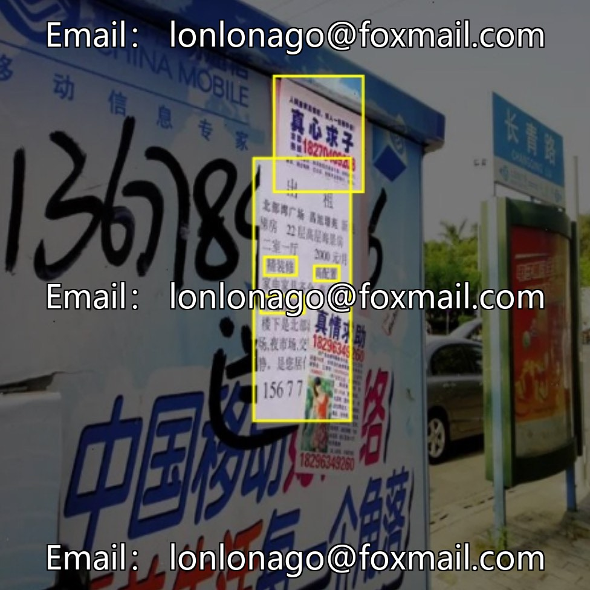
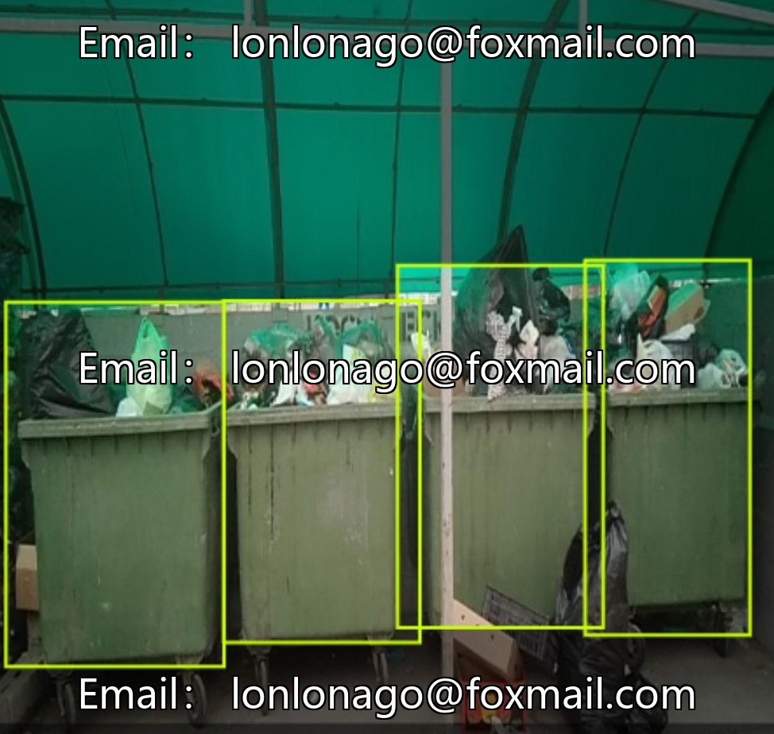
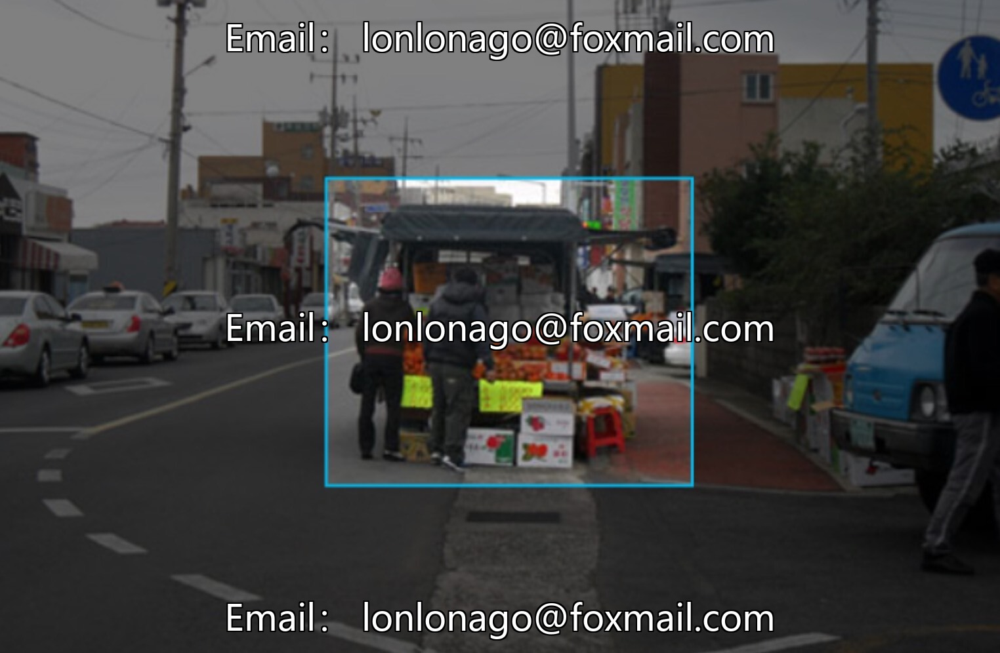
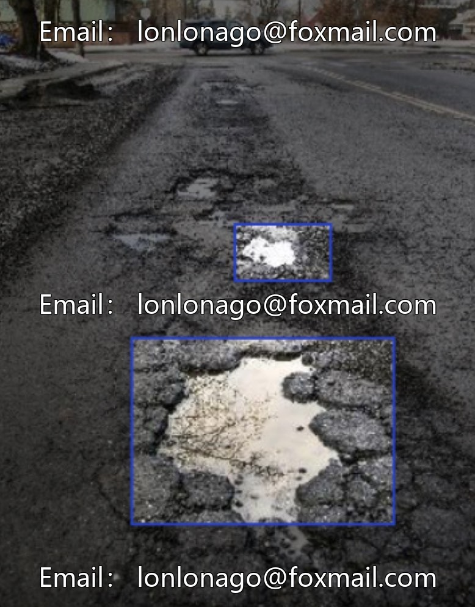
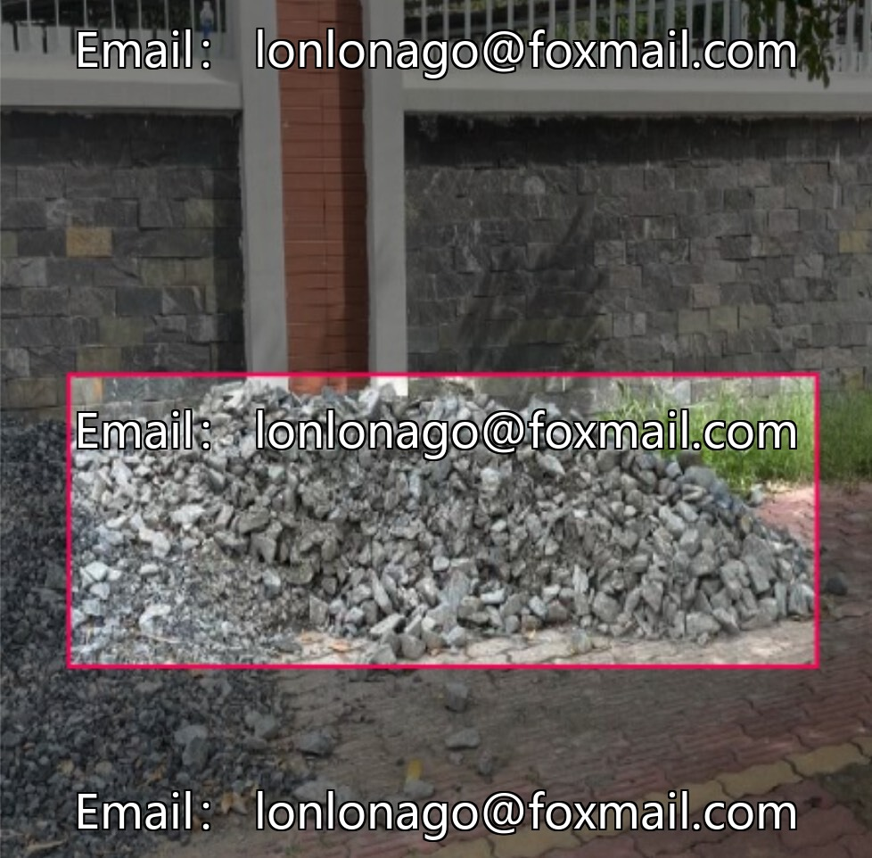
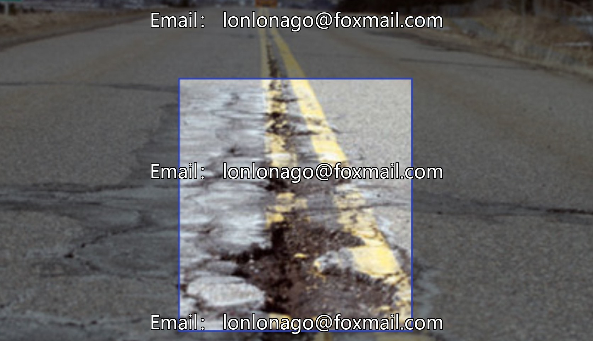
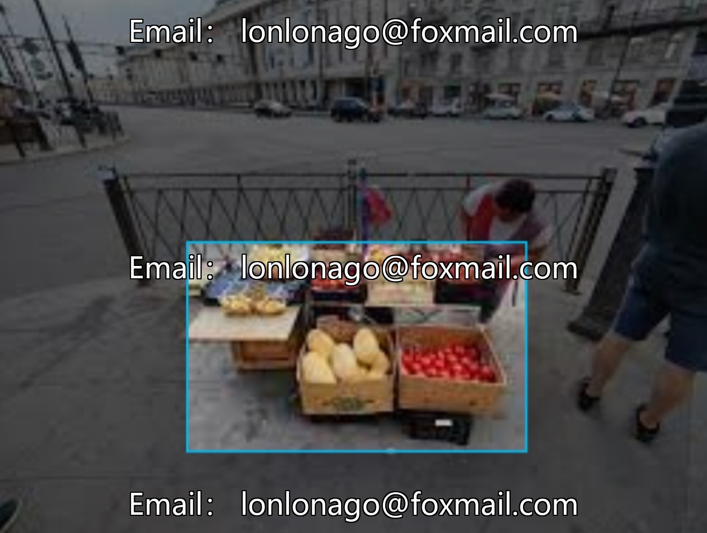
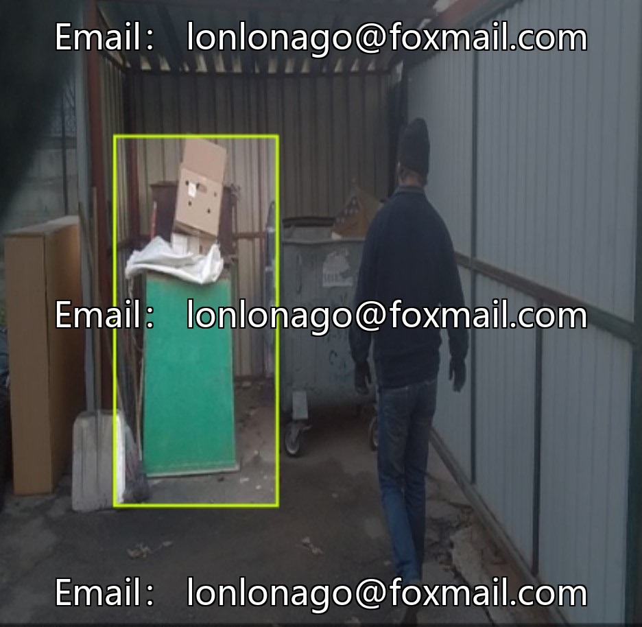

# Smart City Garbage Illegal Detection Data Set

## Body

Smart City Waste Illegal Detection Data Set for Smart City Governance - Target Detection Datasets for Illegal Garbage Overflow, Illegal Stacking, Illegal Stalls, Abnormal Sewer Covers, Road Ditches, etc., in the format of yolo26, comprising 3200 images, with 7 categories of target annotations, covering scenarios such as urban facility inspection, urban appearance supervision, road construction, etc., suitable for model training and algorithm optimization.

The dataset structure is clear, directly usable for training YOLO series models, supporting the development of deep learning models and performance evaluation.

Virtual materials, once sold, are non-refundable.
Interested friends, click "I want" to proceed.

## Images

## Payment

Here is a pay link on Stripe ( https://buy.stripe.com/3cs8yP7sY87d0vu9AB ). Please contact me lonlonago@foxmail.com after funding $89, and I will send you a complete data files , thank you!

